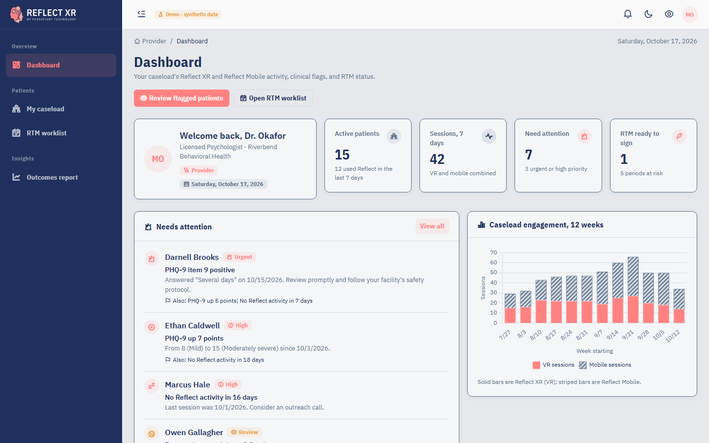

# Reflect Provider Dashboard (Reflect XR extension)

A clinician-facing dashboard for **Reflect XR** (VR) and **Reflect Mobile**. Providers see each patient's engagement, therapeutic response (mood check-ins, PHQ-9, GAD-7), rule-based clinical flags, an optional AI pre-session brief, and a full **Remote Therapeutic Monitoring (RTM)** workflow: data days, management time, live-call tracking, billing readiness for the 2026 CPT codes, and period sign-off.

It is built as an isolated extension that follows the *Reflect XR Web App: Tech Spec for Extension Teams* (v1.12.4): .NET 10 MVC, one new Area, thin controllers with fat ViewModels, repository interfaces with in-memory stand-ins, vendored front-end libraries, and a strict nonce-based CSP. **All data is synthetic.**



## Run it

Requires the .NET 10 SDK. No database, secrets, or external services are needed.

```bash
dotnet build
dotnet run --project src/Reflect.Web
```

Open http://localhost:5075. You're signed in as **Dr. Maya Okafor** (demo). Switch users from the profile menu (top right):

| Demo user | Sees |
|---|---|
| Dr. Maya Okafor, PhD | 16 patients at Riverbend Behavioral Health |
| Jordan Reyes, LCSW | 7 different patients at Harbor Light Counseling |
| Sam Patel (End User) | Access denied (no Provider role) |

Synthetic data is regenerated relative to today on every start. Details: [docs/SETUP.md](docs/SETUP.md).

## Screens

| Screen | URL | What it does |
|---|---|---|
| Dashboard | `/Provider/Home/Dashboard` | Caseload KPIs, patients needing attention (one row per patient), 12-week VR vs mobile engagement, RTM periods closing this week, recent sessions |
| My caseload | `/Provider/Patients/Index?filter=all\|attention\|atrisk\|ready` | Sortable, searchable patient list with last activity, sessions, VR/mobile split, data-day progress, RTM status and flags |
| Patient details | `/Provider/Patients/Details/{id}?tab=…` | Seven tabs: **Overview** (KPIs, clinical insights, AI brief, engagement/module/mood charts) · **Sessions** · **Therapeutic response** (PHQ-9/GAD-7 trend with severity bands, item 9, mood check-ins) · **RTM** (monitoring-status table, billing readiness, time log, sign-off, history) · **Notes** · **Care plan** (read-only) · **Access log** |
| Log management time | `/Provider/Rtm/LogTime?patientId={id}` | Create form: date, minutes, activity, interactive communication and method, notes |
| Add note | `/Provider/Notes/Create?patientId={id}` | Create form for a clinical note |
| Edit care plan | `/Provider/CarePlan/Edit/{patientId}` | Edit page (all fields on one page) for RTM enrollment, diagnosis, consent/setup dates, goals, status |
| RTM worklist | `/Provider/Rtm/Index?filter=open\|ready\|atrisk\|ontrack\|signed\|all` | Every patient's current 30-day period: data days, minutes, live call, supported codes, documentation, next step |
| Outcomes report | `/Provider/Reports/Outcomes` | Caseload-level mood change by module, PHQ-9 change by engagement level, VR vs mobile (labelled correlational) |
| JSON: engagement | `GET /Provider/Patients/EngagementData/{id}?weeks=4\|12\|26` | Chart data for the range buttons |
| JSON: brief | `POST /Provider/Patients/Brief/{id}` | Pre-session brief (anti-forgery token required) |

The sidebar entries are in the real menu format in [`src/Reflect.Web/Areas/Provider/provider-menu.json`](src/Reflect.Web/Areas/Provider/provider-menu.json).

## Entities and interfaces added

All in `src/Reflect.Domain`, inheriting the spec's `BaseEntity` (soft delete, UTC `DateTimeOffset`).

| Context | Entity | Purpose |
|---|---|---|
| Analytics (no PHI) | `EngagementSession` | One app session built from Firebase/GA4 events; keyed only by a pseudonymous `AppUserKey` |
| Clinical (PHI) | `ProviderProfile` | Clinician; links to the real local user id |
| | `Patient` | Person under care |
| | `PatientAppLink` | The only bridge between analytics and clinical data; records data-sharing consent |
| | `CarePlan` | RTM enrollment: program, ICD-10, consent, monitoring start, 98975 setup date, goals, status |
| | `Observation` | FHIR-style value (LOINC where standard): mood check-ins, PHQ-9, PHQ-9 item 9, GAD-7; future RPM data fits without schema change |
| | `ProviderTimeEntry` | RTM treatment-management minutes, with interactive-communication flag and method |
| | `ClinicalNote` | Provider note |
| | `RtmPeriodReview` | Documentation status and sign-off for a 30-day period |
| | `PhiAccessLog` | Who viewed or used a patient's PHI, and when |

| Interface | Notes |
|---|---|
| `IProviderProfileRepository`, `IPatientRepository`, `IPatientAppLinkRepository`, `ICarePlanRepository`, `IObservationRepository`, `IProviderTimeEntryRepository`, `IClinicalNoteRepository`, `IRtmPeriodReviewRepository`, `IPhiAccessLogRepository` | One per entity, async with `CancellationToken`. `IPatientRepository.GetForProviderAsync` enforces caseload scoping |
| `IEngagementSessionRepository` | Session read model (production: refreshed from BigQuery) |
| `IAnalyticsEventSource` | Port to raw Firebase/GA4 events (production: BigQuery query) |
| `IClinicalBriefGenerator` | Pre-session brief; rule-based by default, Claude when an API key is set |

Pure, tested logic lives in `Reflect.Domain/Rules`: `RtmCalculator`, `InsightEngine`, `EngagementEventMapper`, `PatientMonitoringSummaryBuilder`, `OutcomesCalculator`, `BriefInputFactory` (the de-identification boundary), `RuleBasedBriefComposer`, `MeasureSeverity`, `UsDateExtensions`.

## Libraries

**Added beyond Part 2**

| Library | Version | Where | Why |
|---|---|---|---|
| Chart.js | 4.4.9 | `wwwroot/assets/libs/chart.js/` (vendored, unchanged) | Charts. Part 2 lists no chart library. If the real theme already vendors ApexCharts, the four chart configs are small to port |
| Anthropic .NET SDK | 12.58.0 (NuGet, server-side) | `Infrastructure/Provider/ClaudeClinicalBriefGenerator.cs` | Optional AI brief. Only used when an API key is configured; never called from the browser |

**From Part 2, at the spec's versions:** jQuery 3.7.1, Bootstrap 5.3.3 + Popper 2.11.8 (bundle), DataTables 1.13.8 + Bootstrap 5 + Responsive 2.5.0, Choices.js 10.2.0, flatpickr 4.6.13, SweetAlert2 11.26, Toastr 2.1.4, jquery.validate 1.21.0 + unobtrusive 4.0.0, RemixIcon 4.2. Not needed by these screens: Cropper.js, SimpleBar, node-waves, Swiper, Pickr, autoComplete.js.

**Fonts:** IBM Plex Sans (400, italic, 600) and IBM Plex Sans Condensed (700) as `.woff2` from IBM's official `@ibm/plex` release, in `wwwroot/fonts`.

## Merging into Reflect XR

| Keep (copy into the real solution) | Delete (stand-ins) |
|---|---|
| `src/Reflect.Domain/**` (entities, interfaces, rules) | `src/Reflect.Web/Standins/**` (auth, current user, CSP, in-memory data, seeder, menu renderer) |
| `src/Reflect.Web/Areas/Provider/**` (controllers, views, policy, DI, menu JSON) | `src/Reflect.Web/wwwroot/standins/**` (theme tokens, shell CSS/JS, shared-service stand-ins, logos) |
| `src/Reflect.Web/Models/ViewModels/Provider/**`, `Models/Messages/ProviderMessages.cs` | `Views/Shared/_Layout.cshtml`, `_StandinAccessibilityPanel.cshtml`, `Components/SidebarMenu`, `Error`, `NotFound`, `Views/Account`, `Controllers/HomeController.cs` |
| `src/Reflect.Web/Infrastructure/Provider/**` (move to `Reflect.Infrastructure`) | The `AddDemoStandins()` / `SeedDemoDataAsync()` lines in `Program.cs` |
| `wwwroot/css/provider/`, `wwwroot/js/controllers/provider/`, `wwwroot/js/services/provider/`, `wwwroot/assets/libs/chart.js/` | |
| `tests/**` (move into the real test project) | |

On merge:
1. Point the `ProviderOnly` policy at the real role (we used a proposed `Provider` claim).
2. Add the repositories to `IUnitOfWork`; `ProviderRepositories` is a stand-in for that facade.
3. Map the toast `TempData` keys (`ToastMessage`, `ToastType` in `ProviderMessages`) to the real layout's keys.
4. Fix the `@using Reflect.Web.Standins.Security` line in `Areas/Provider/Views/_ViewImports.cshtml` to wherever the real `GetCspNonce()` lives.

The views assume the real layout loads jQuery, Bootstrap, DataTables, Toastr and SweetAlert2 globally (as the shared services imply), and they load Chart.js, flatpickr and Choices themselves through `@section Scripts`.

## Tests

```bash
dotnet test
```

**83 tests.**

- `Reflect.Domain.Tests` (68): RTM periods, data days and every CPT threshold; insight rules; GA4 event mapping; US date and Eastern-time handling, including daylight saving; outcomes tiers; and the brief de-identification boundary.
- `Reflect.Web.Tests` (15): the spec's code-review rules, checked automatically:
  - every `ri-*` class exists in RemixIcon 4.2
  - no inline handlers
  - a nonce on every inline script
  - no CDN URLs
  - rem units and theme tokens only
  - the menu JSON format
  - `[Area]`, `[Authorize(Policy)]` and no-store on every controller
  - `[ValidateAntiForgeryToken]` on every POST
  - no `string?`
  - vendored library versions
  - ViewModel validation and caseload scoping

## Documentation

- [docs/SETUP.md](docs/SETUP.md): setup, configuration (AI brief, CSP), troubleshooting
- [docs/ARCHITECTURE.md](docs/ARCHITECTURE.md): production data flow (Firebase → BigQuery → Azure SQL), analytics vs clinical separation, RTM and insight rules, AI brief, HIPAA and security, accessibility
- [docs/API.md](docs/API.md): endpoints in this extension, domain contracts, the analytics event contract and BigQuery sync query, proposed Reflect.Api endpoints for therapeutic-response and RPM data
- [docs/DEMO-SCRIPT.md](docs/DEMO-SCRIPT.md): a 6-minute walkthrough
- [docs/Project-Summary-Report.pdf](docs/Project-Summary-Report.pdf): two-page project summary
- [CHANGELOG.md](CHANGELOG.md)
