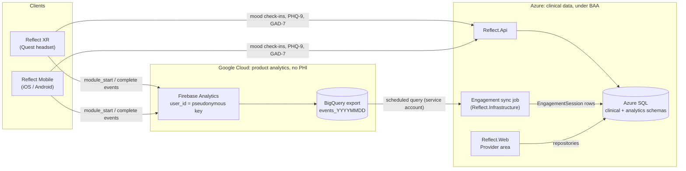
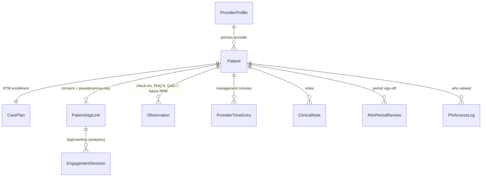

# Architecture

This document explains how the Provider Dashboard is built and how it should run in production. It covers:

- where the data comes from
- how product analytics stay separate from clinical data
- how RTM and the clinical flags are calculated
- how PHI is protected

## 1. Where it fits in Reflect XR

Reflect XR is one backend database with three clients. The extension adds a fourth role-specific Area to the existing web app and changes nothing else.

```
Reflect.Domain          entities + interfaces              <- Provider entities, interfaces, pure rules
   ↑
Reflect.Infrastructure  EF Core, Stripe, OpenAI, Blob...    <- EF repositories + BigQuery sync job (to add on merge)
   ↑            ↑
Reflect.Web     Reflect.Api                                 <- Web: new "Provider" Area. Api: therapeutic-response endpoints (proposed)
```

The demo ships the two layers the spec asks for: `Reflect.Domain` and `Reflect.Web`. Everything the real app already provides is a stand-in in clearly marked folders. That covers the layout, sign-in, `ICurrentUserService`, the CSP nonce, persistence and the shared JS services.

Each screen follows the spec's pattern:
- **Controller**: thin, with `[Area("Provider")]`, `[Authorize(Policy = "ProviderOnly")]` and `[ResponseCache(NoStore = true)]`.
- **ViewModel**: fat. `PrepareData` loads data; `PrepareDataForSave` validates and returns a `…SaveData` object. Only the controller persists.
- **View**: Razor, using `card custom-card` and `page-title`.
- **Per-screen JS**: a controller script exposing `init(...)`, called from a nonce'd inline script, plus a `…Service.js` of `$.ajax` Promise wrappers for screens with AJAX endpoints.

## 2. Production data flow (target)

The challenge brief proposes Firebase Analytics with BigQuery behind a secure backend, and asks for product analytics to be kept apart from clinical data. That gives two pipes that meet only inside the HIPAA boundary:



**Product analytics: Firebase → BigQuery → sync job → `analytics` schema.**
- The apps log a small set of custom events (`module_start`, `creation_saved`, `module_complete`, `module_exit`) carrying only a module id and a Reflect session id.
- Firebase's `user_id` is set to a pseudonymous key, never an email or name.
- A scheduled job in the backend queries the BigQuery export and maps events into `EngagementSession` rows with `EngagementEventMapper`. The query is in [API.md](API.md#bigquery-sync-query). The job runs every 15 minutes, using the `events_intraday_*` tables for same-day data.
- The dashboard reads the read model, never BigQuery directly. Pages stay fast and BigQuery cost stays flat.

**Clinical data: apps → Reflect.Api → `clinical` schema.**
- Mood check-ins and questionnaire answers are therapeutic-response data. When linked to a patient they are PHI, so they never go to Firebase.
- The apps post them to Reflect.Api, which stores them as `Observation` rows in Azure SQL.
- Each observation carries the Reflect session id, so a check-in lines up with the session it belongs to.

**The join.**
- `PatientAppLink` maps a patient to their pseudonymous app key and records their consent to share app data with the care team.
- It lives only in the clinical store, so analytics alone can't identify anyone.

**In the demo:**
- `SyntheticAnalyticsEventSource` produces events in the BigQuery export shape.
- `EngagementSync` runs the real mapper once at startup.
- The seeder writes clinical rows straight into the in-memory store.

| Production component | Demo stand-in |
|---|---|
| Firebase Analytics + BigQuery export | `SyntheticAnalyticsEventSource` (GA4-shaped events) |
| Scheduled BigQuery sync job | `EngagementSync.RunAsync` at startup, same `EngagementEventMapper` |
| Azure SQL via EF Core | `InMemory*Repository` over `InMemoryStore` |
| Reflect.Api therapeutic-response endpoints | `SyntheticDataSeeder` writes `Observation` rows |
| Entra External ID | `DemoAuthenticationHandler` + user switcher |
| OpenAI/Claude service in Infrastructure | `IClinicalBriefGenerator` (rule-based, or Claude with a key) |

### Adding therapeutic-response and RPM data later

`Observation` follows the FHIR Observation resource: code system + code, numeric value, unit, source, effective time, and an optional session reference.

- **Today:** mood check-ins (`reflect-mood-pre`, `reflect-mood-post`), PHQ-9 total (LOINC `44261-6`), PHQ-9 item 9 (`44260-8`) and GAD-7 total (`70274-6`).
- **Remote Physiologic Monitoring:** for example heart rate, LOINC `8867-4`, from a headset or wearable. That is new rows with `Source = Device` and a new code. There's no new table and no migration.
- **Rules and charts** key off codes, so a new measure needs a code constant and, if wanted, a rule.
- **FHIR export** to an EHR maps one-to-one from this table.

## 3. Domain model



All entities inherit `BaseEntity`:
- `Guid Id`
- `DateCreated` in UTC
- soft delete (`IsDeleted`, `DateDeleted`), and every repository filters deleted rows

Dates are stored as UTC `DateTimeOffset`. Calendar-only values (service date, monitoring start, period bounds) are `DateOnly`. The display helpers convert to US Eastern with `CultureInfo.InvariantCulture`.

`PatientMonitoringSummaryBuilder` turns one patient's rows into everything a screen needs, in one pass:
- 7- and 30-day engagement
- RTM assessment
- the challenge's monitoring-status metrics
- insights
- the latest scores

`CaseloadDataLoader` loads a whole caseload in a fixed number of queries (no N+1) before building summaries.

## 4. Remote Therapeutic Monitoring

RTM is treated as a clinical workflow, not an analytics widget. The app tracks what a provider has to document and shows which codes the numbers support. Any provider can then review and sign the period.

### Rules (CPT 2026, CBT-category device codes for mental-health monitoring)

| Code | What the app checks |
|---|---|
| 98975 | Setup and patient education. Eligible in the period containing the care plan's *setup completed* date (once per episode) |
| 98986 | Device supply, **2-15** qualifying data days in the 30-day period (new for 2026) |
| 98978 | Device supply, **16-30** qualifying data days in the 30-day period |
| 98979 | Treatment management, **10-19 minutes** in the calendar month, with at least one real-time interactive communication (new for 2026) |
| 98980 | Treatment management, **20+ minutes** in the calendar month, with at least one real-time interactive communication |
| 98981 | Each additional full 20 minutes beyond the first 20 |

- **Device-supply periods** are consecutive 30-day windows starting on the monitoring start date.
- **Management time** is counted per calendar month, as the descriptors require.
- **A qualifying data day** is a US Eastern calendar day with a completed Reflect session or a patient-reported entry (check-in or questionnaire).
- **Interactive communication** means real-time, two-way audio, with video optional. Secure messages don't count, and the Log time form says so.
- **Thresholds** live in one `RtmRules` record so billing or compliance can adjust them. The UI labels everything as decision support and reminds users that 98978/98986 may be contractor-priced.

### Readiness (`RtmCalculator.Assess`)

| State | When |
|---|---|
| Not monitoring | Care plan paused or completed |
| Signed | The provider signed this period |
| Ready to sign | 16+ data days and a management code supported; or the last day of the period with 2+ data days and a management code |
| At risk | 16 data days can no longer be reached; or more than 80% of the remaining days need data; or 7 or fewer days left with no live call |
| On track | Everything else |

The reasons ("Needs 4 more data days in the next 9 days", "No real-time interactive communication logged this month") appear on the RTM tab and the worklist.

The RTM tab reproduces the challenge brief's monitoring-status table:
- active/qualifying data days
- sessions
- total engagement
- therapeutic-response entries
- provider reviews
- patient communications
- provider management time
- documentation status

## 5. Clinical insights

`InsightEngine` is deterministic and explainable. Its flags are prompts for review, not diagnoses. Every patient page says the dashboard isn't monitored in real time, and that patients are directed to 988 inside the apps.

| Rule | Fires when | Severity |
|---|---|---|
| PHQ-9 item 9 positive | Latest item 9 ≥ 1, within 30 days | Urgent |
| PHQ-9 worsening | Latest minus previous PHQ-9 ≥ 5 | High |
| GAD-7 worsening | Latest minus previous GAD-7 ≥ 5 | Review |
| PHQ-9 improving | Baseline minus latest ≥ 5 (and not worsening) | Positive |
| No Reflect activity | No session for 7+ days (High at 14+) | Review / High |
| Engagement drop | Last 7 days below 50% of the prior 4-week weekly average (average ≥ 2) | Review |
| Mood decline | Average pre-session mood over the last 14 days at least 1.5 below the prior 14 (3+ check-ins each) | Review |
| Mood lift | Average after-minus-before mood ≥ +1.0 over 30 days (4+ pairs) | Positive |
| No data since enrollment | Enrolled 3+ days, no sessions | Review |
| RTM at risk / ready to sign | From the RTM calculator | Review / FYI |

- **Paused care plans:** only the questionnaire rules run, so a paused patient isn't flagged for inactivity.
- **Severity bands:** PHQ-9 0-4 minimal, 5-9 mild, 10-14 moderate, 15-19 moderately severe, 20-27 severe. GAD-7 0-4, 5-9, 10-14, 15-21.
- **Clinically meaningful change:** a 5-point change is treated as meaningful.

## 6. Pre-session brief (generative AI)

- **Rule-based by default.** `IClinicalBriefGenerator` has two implementations. `RuleBasedClinicalBriefGenerator` always works offline.
- **Claude when a key is set.** `ClaudeClinicalBriefGenerator` is used when an Anthropic API key is configured.
- **De-identification boundary.** `BriefInputFactory` builds the only thing that leaves the server:
  - aggregates
  - a 10-year age band
  - "days ago" instead of dates
  - the diagnosis description
  - flag titles and an RTM summary

  It never includes a name, MRN, date of birth, app key, exact date, or anything the patient wrote. A unit test asserts this.
- **Call.** The official Anthropic .NET SDK; model `claude-opus-5-5` at low effort, server-side refusal fallback enabled, and a fixed system prompt (factual, no diagnosis, safety flags first). The reply is parsed as JSON.
- **Failure.** Any error, refusal or unparseable reply falls back to the rule-based brief with a notice.
- **Labelling.** The UI marks the result as *AI draft* or *Rule-based summary*, and every request is written to the PHI access log.
- **Production.** Sending even de-identified clinical data to a model provider should sit under a BAA. PTI already integrates OpenAI in Infrastructure, so an OpenAI implementation of the same interface is a one-class swap.

## 7. Security and HIPAA posture

| Control | How |
|---|---|
| Role-based access | One named policy (`ProviderOnly`) on every Provider controller (verified by a test). The real team points it at the real role |
| Caseload scoping (minimum necessary) | Every patient lookup goes through `IPatientRepository.GetForProviderAsync(patientId, providerId)`. Another provider's patient returns **404**, not 403, so a record's existence isn't revealed. Covered by tests |
| PHI read audit | `PhiAccessLog` row on every patient view and brief request, shown on the Access log tab. Writes are already audited by the real app |
| No caching of PHI | `Cache-Control: no-store` on every Provider response |
| Content Security Policy | Real app's policy; demo defaults to the stricter per-request nonce mode for scripts. Every inline script is nonce'd; no inline handlers; everything same-origin (all verified by tests and a browser run with zero CSP violations) |
| CSRF | `[ValidateAntiForgeryToken]` on every POST (verified by a test); AJAX sends `__RequestVerificationToken` |
| Analytics without PHI | Firebase events carry a pseudonymous key and module ids only. Firebase Analytics shouldn't be treated as HIPAA-eligible; confirm against Google's [HIPAA covered products](https://cloud.google.com/security/compliance/hipaa) list. The linkage table lives only in Azure SQL |
| AI | De-identified input only, server-side calls, labelled output, fallback without AI |
| Data | Synthetic only (fictional names, `.example` domains, generated MRNs) |
| Production checklist | Entra session timeout and MFA for clinicians; Azure SQL TDE and TLS 1.2+; BAAs with Microsoft, Google (BigQuery) and any model provider; retention policy for access logs; break-glass access procedure |

## 8. Accessibility and UI rules

- **Sizing:** all sizes in `rem`, so the accessibility panel's text scaling reaches every screen, including chart fonts, which are computed from the root font size and redrawn on change.
- **Status is never color alone.** Every status badge has an icon and a label. Score changes say "(worse)" or "(better)" next to an arrow. Chart series differ by pattern and dash as well as color: VR is solid and mobile is striped; "before" is dashed with triangles.
- **Color-blind mode** (`data-a11y-colorblind`) and **light/dark mode** (`data-theme-mode`) are honored. All colors come from the spec's tokens. The one constant in `provider.css` is Twilight Indigo for text placed on Soft Coral.
- **Contrast note for PTI:** white text on Soft Coral is about 2.4:1, below WCAG AA. Twilight Indigo on Soft Coral is about 5.3:1.
- **Layout:**
  - nav-tabs for the many-section patient page
  - every create and edit form on one page
  - existing data (care plan) opens read-only with a separate Edit page
  - page buttons stack full-width below 576px
  - no horizontal scroll at 390, 820 or 1440px (checked with Playwright)
- **Charts:** every chart has `role="img"` with a text summary, plus a visible caption.

## 9. Testing

- **Unit tests (`Reflect.Domain.Tests`):** RTM periods and thresholds, insight rules, event mapping, Eastern-time dates (including DST), outcomes tiers, and the brief de-identification boundary.
- **Spec-compliance tests (`Reflect.Web.Tests`):** icons, nonces, inline handlers, CDN use, rem/tokens, menu format, policy/area/no-store on controllers, anti-forgery on POSTs, no `string?`, and library versions. Also ViewModel validation and caseload scoping against the synthetic data.
- **Manual and browser QA:** every screen in light, dark, color-blind and 125% text, at phone, tablet and desktop widths, with zero console errors or CSP violations.
